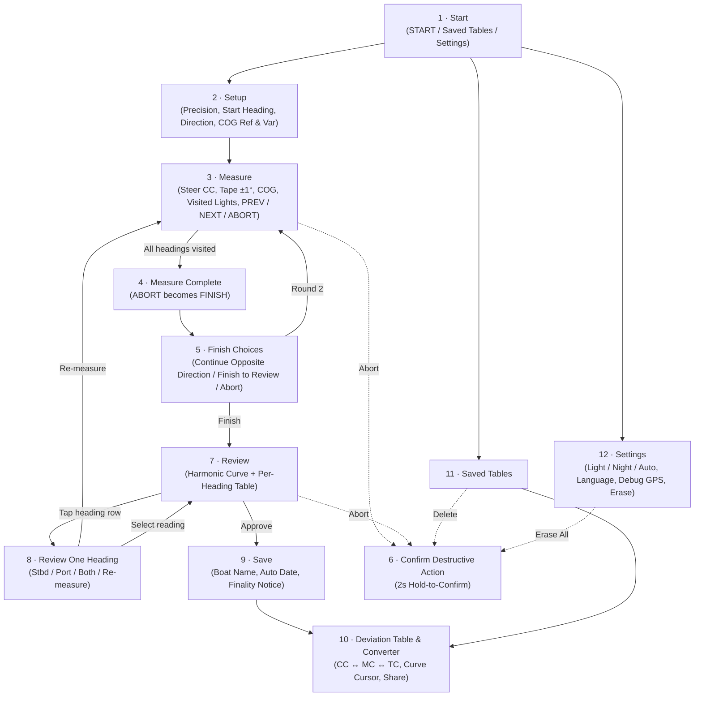

# Deviator (`navigart-deviator`)

> **Live App**: [deviator.navigart.net](https://deviator.navigart.net)  
> **Documentation Map**: [GEMINI.md](GEMINI.md) · **Why?** [SPEC.md](SPEC.md) · **What?** [README.md](README.md) · **How?** [AGENTS.md](AGENTS.md)

**Deviator** is an offline-first Progressive Web App (PWA) for swinging a yacht's magnetic compass, building its deviation curve and table, and converting courses between **Compass**, **Magnetic**, and **True**.

---

## What It Does

1. **Measure Deviation ("Swinging the Compass")**
   - Guides helmsman and navigator through `4`, `6`, `8` (default), `10`, or `12` evenly spaced compass headings.
   - Supports a single 360° round or two opposite-direction rounds (**Starboard `▶`** and **Port `◀`**) on the same heading grid to cancel compass and helm turning lag.
   - Accepts **Chartplotter COG** in either **True** (with local Magnetic Variation) or **Magnetic** reference.
   - Uses a cockpit-friendly **drag-only heading tape** and **`±1°` steppers**—no popup keyboards.

2. **Review & Resolve Readings**
   - Plots the continuous 5-coefficient harmonic deviation curve ($\delta(c) = A + B\sin c + C\cos c + D\sin 2c + E\cos 2c$) alongside raw Starboard (`▶`) and Port (`◀`) measurements.
   - Lets students inspect each heading and choose **Starboard only**, **Port only**, **Both (averaged)**, or **Re-measure** before instructor sign-off.

3. **Save Immutable Boat Tables**
   - Stores approved deviation tables locally on the device by **Boat Name** and **Date**.
   - Once saved, tables are final and cannot be altered.

4. **Convert Any Course (`Compass ↔ Magnetic ↔ True`)**
   - Interactive converter with live curve cursor, per-heading quick-jump table strip, and heading tape.
   - Converts **Compass → Magnetic** (direct harmonic evaluation) and **Magnetic → Steer Compass** (fixed-point iterative inverse) while displaying **True** course for the active magnetic variation.

5. **Share Without a Backend**
   - Exports a human-readable deviation table for chat apps (WhatsApp, Signal, SMS) together with a self-contained `#t=v1&...` URL hash link that other crew members can open to import the table.

---

## Screen Flow

---

## Repository Structure

| Path | Description |
| :--- | :--- |
| [GEMINI.md](GEMINI.md) | Documentation map linking Why ([SPEC.md](SPEC.md)), What ([README.md](README.md)), and How ([AGENTS.md](AGENTS.md)). |
| [SPEC.md](SPEC.md) | **Why?** Domain background, pedagogical rationale, UX philosophy, and scope. |
| [README.md](README.md) | **What?** Functional overview, screen flow, and repository layout. |
| [AGENTS.md](AGENTS.md) | **How?** Engineering architecture, mathematical formulas, UX invariants, and testing guide. |
| [`WIP/mock/`](WIP/mock/index.html) | Interactive 12-state HTML/CSS/JS prototype validating layout, themes, math, and controls across viewports. |
| `docs/` *(planned)* | Production zero-dependency PWA served via GitHub Pages at `deviator.navigart.net`. |
